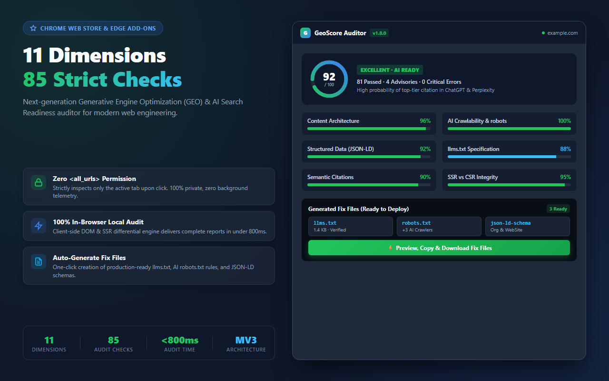
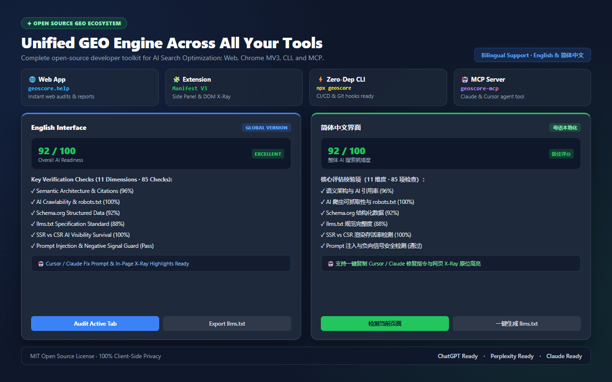
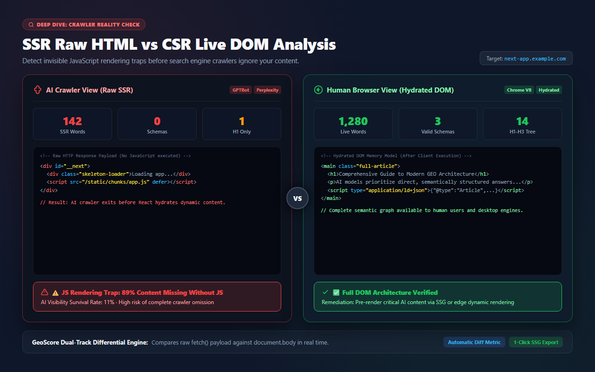
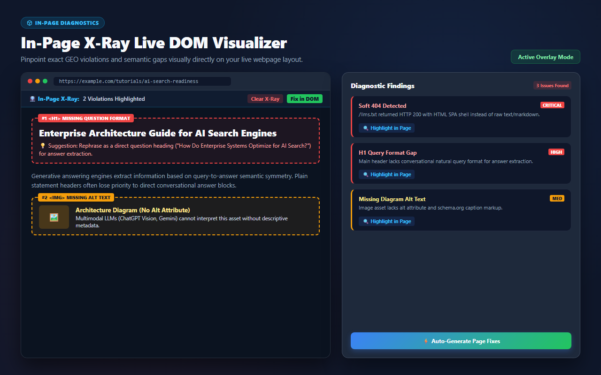
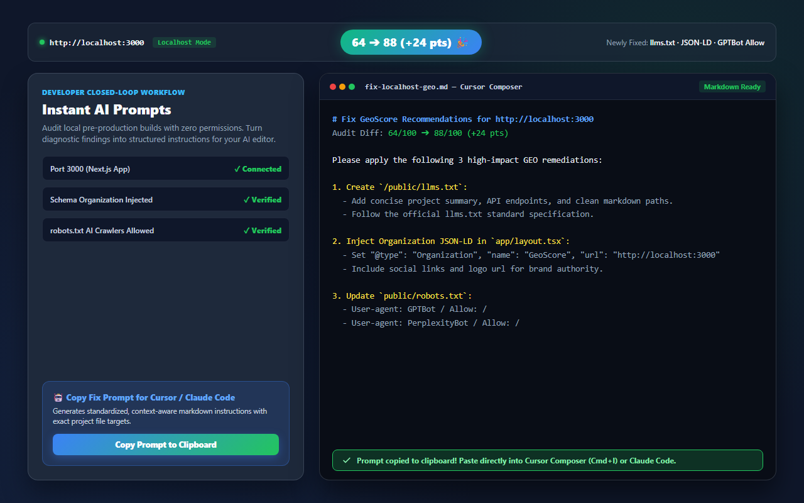

# GeoScore 🌐 — GEO Audit Tool for AI Search Visibility

**Check your website's visibility to ChatGPT, Perplexity, Claude, Gemini, and Google AI Overviews.**  
*Audit locally via Chrome Extension or Terminal CLI; Generate 1-Click Code Fix Packs on [geoscore.help](https://geoscore.help/).*

[](LICENSE)
[](https://chromewebstore.google.com/detail/geoscore-free-geo-aeo-llm/cboppgehhkhaamcgfcikhekkdaelichn)
[](https://astro.build)
[](https://pages.github.com)
[](CONTRIBUTING.md)

<p align="center">
  <a href="https://chromewebstore.google.com/detail/geoscore-free-geo-aeo-llm/cboppgehhkhaamcgfcikhekkdaelichn">
    
  </a>
</p>

---

## 🚀 Try It & Ecosystem Quickstart

- **Web Audit & Remediation Hub**: [geoscore.help](https://geoscore.help) — Full instant audit, radar charts, and 1-click **$49 Fix Pack** download.
- **Official Chrome Extension**: [Chrome Web Store](https://chromewebstore.google.com/detail/geoscore-free-geo-aeo-llm/cboppgehhkhaamcgfcikhekkdaelichn) — Audit open tabs, debug localhost, and inspect live DOM differences.
- **Terminal CLI (Zero Install)**: `npx geoscore https://example.com` — Fast 11-dimension scan with JSON/CI gate support.
- **MCP Server for AI Agents**: `npx geoscore-mcp` — Real-time GEO context and automatic remediation for Claude Desktop & Cursor.

> 💡 **Open-Core Model**:
> - **Free & Open-Source (MIT)**: Core 11-dimension 85-signal audit engine, CLI scanner (`npx geoscore`), Chrome Side Panel extension, and MCP Server.
> - **Commercial Services on [geoscore.help](https://geoscore.help/)**: 1-Click **$49 Automated Code Fix Pack** (`llms.txt`, `robots.txt`, JSON-LD schemas), weekly automated AI search citation monitoring, and bespoke enterprise consulting.

## 📖 What is GeoScore?

GeoScore is a **free, open-source, web-based GEO (Generative Engine Optimization) audit tool** that:

1. **Scans** your website for AI-search signals (robots.txt, llms.txt, JSON-LD, meta tags, content quality, E-E-A-T, and more)
2. **Scores** 0–100 across 11 weighted dimensions + negative signals deduction + prompt injection detection
3. **Recommends** prioritized fixes with ready-to-paste code snippets
4. **Exports** reports as Markdown, JSON, or CSV
5. **Monitors** your AI visibility over time with scheduled re-audits (Pro)

No installation required. Just enter a URL. Available in [English](https://geoscore.help) and [Chinese](https://geoscore.help/zh/).

## 🧠 Scoring System

GeoScore synthesizes frameworks from the leading GEO/AEO open-source projects:

| Dimension | Weight | Source |
|-----------|--------|--------|
| AI Crawlability (Robots.txt) | 12% | geo-optimization-handbook, Auriti-Labs |
| AI Guidance (llms.txt) | 12% | geo-optimization-handbook, best-aeo-skill |
| Structured Data (Schema) | 14% | handbook, evolv3ai, Auriti-Labs |
| Meta & Social Tags | 10% | geo-optimization-handbook, piiiico |
| Content Quality | 12% | handbook, Auriti-Labs, geo-optimizer (Go) |
| E-E-A-T Signals | 8% | evolv3ai, best-aeo-skill |
| Brand & Entity | 8% | geo-optimization-handbook, best-aeo-skill |
| Citation Readiness | 8% | best-aeo-skill, geo-seo-claude |
| Discovery Endpoints | 6% | geo-optimization-handbook |
| Agent-Friendliness | 4% | ax-score, agentscore |
| Freshness & Maintenance | 4% | evolv3ai |
| Negative Signals | Deduction | handbook + UC Berkeley EMNLP 2024 |
| Prompt Injection Detection | Deduction | Handbook + OWASP LLM Top 10 |

**Score Levels:**
- **86–100** ⭐ Excellent — Fully GEO-optimized
- **68–85** ✅ Good — Minor gaps remain
- **36–67** ⚠️ Basic — Significant work needed
- **0–35** 🔴 Critical — Major overhaul required

## 🏗 Architecture & Ecosystem

<p align="center">
  
</p>

GeoScore delivers a comprehensive 4-in-1 toolchain covering the full GEO optimization lifecycle:

```
┌─────────────────────────────────────────────────────────────────────────────┐
│                            GeoScore Core Engine                             │
│                  11 Dimensions · 20 AI Crawlers · 85 Checks                 │
└───────┬──────────────────────┬──────────────────────┬────────────────┬──────┘
        │                      │                      │                │
        ▼                      ▼                      ▼                ▼
┌────────────────┐    ┌─────────────────┐    ┌──────────────────┐   ┌─────────────────┐
│    Web App     │    │ Chrome Extension│    │     CLI Tool     │   │   MCP Server    │
│(geoscore.help) │    │  (Manifest V3)  │    │  (npx geoscore)  │   │ (geoscore-mcp)  │
├────────────────┤    ├─────────────────┤    ├──────────────────┤   ├─────────────────┤
│• Free browser  │    │• In-tab audit   │    │• Terminal audits │   │• Claude Desktop │
│  instant audit │    │  (Side Panel)   │    │• CI/CD pipeline  │   │  & Cursor agent │
│• Radar charts  │    │• Localhost/dev  │    │• JSON, HTML &    │   │• Zero-config    │
│• Sitemap batch │    │• Bypass WAF/CORS│    │  quiet modes     │   │  agent tools    │
│• Pro monitor   │    │• SSR vs CSR DOM │    │• Auto-fix export │   │• Real-time GEO  │
│  & cloud sync  │    │  diff analysis  │    │  to ./geo-fixes/ │   │  context        │
└────────────────┘    └─────────────────┘    └──────────────────┘   └─────────────────┘
```

### Ecosystem Capability Matrix

| Capability / Feature | Web App (`geoscore.help`) | Chrome Extension (MV3) | CLI (`npx geoscore`) | MCP Server (`geoscore-mcp`) |
| :--- | :---: | :---: | :---: | :---: |
| **Public Website Audit** | ✅ | ✅ | ✅ | ✅ |
| **Localhost / Dev Server** | ❌ (Proxy blocked) | ✅ (Direct tab access) | ✅ (`http://localhost`) | ✅ |
| **Bypass WAF / Cloudflare** | ❌ (Edge rate limited) | ✅ (Browser execution) | ⚠️ (Depends on IP/WAF) | ⚠️ |
| **SSR vs CSR DOM Diff** | ❌ (Raw HTML only) | ✅ (Live DOM vs SSR) | ❌ (Node fetch) | ❌ |
| **On-Page Visual Highlight** | ❌ | ✅ (Direct DOM inspect) | ❌ | ❌ |
| **Sitemap Batch Scan** | ✅ | ↗️ (Redirects to Web) | ❌ | ❌ |
| **Pro Weekly Monitoring** | ✅ | ↗️ (Links to Cloud) | ❌ | ❌ |
| **CI / CD Pipeline Gate** | ❌ | ❌ | ✅ (`--quiet`, `--json`) | ❌ |
| **AI Agent Integration** | ❌ | ❌ | ⚠️ (Subprocess) | ✅ (Native MCP) |
| **Fix Files Generation** | ✅ (Download) | ✅ (Download/Copy) | ✅ (`--fix`) | ✅ (`generate_fixes`) |

### 💎 Open-Core Architecture & Commercial Division

GeoScore operates under an **Open-Core** philosophy: standard audit algorithms and developer tools are 100% free and open-source, while high-value automation and cloud intelligence are provided commercially on [geoscore.help](https://geoscore.help/).

| Tier | Capability | Deliverables | Pricing & Access |
| :--- | :--- | :--- | :--- |
| **Core Open-Source**<br/>*(MIT License)* | • 11-Dimension / 85-Check Engine<br/>• Terminal CLI Scanner<br/>• Chrome Extension MV3<br/>• MCP Server for AI Agents | Full diagnostic breakdown, 0–100 score, negative signal analysis, and prompt injection detection | **100% Free**<br/>(`npx geoscore` / GitHub) |
| **Automated Fix Pack**<br/>*(Commercial SaaS)* | • 1-Click Code Generation<br/>• Deploy-Ready Config Bundles<br/>• Schema Syntax Guarantee | Tailored `llms.txt`, hardened `robots.txt`, and validated JSON-LD schema snippets to paste directly | **$49 / site**<br/>([geoscore.help](https://geoscore.help/)) |
| **Enterprise Cloud**<br/>*(Commercial SaaS)* | • Multi-Engine Citation Tracking<br/>• AI Search Answer Share Alerts<br/>• Bespoke Consulting | Weekly automated queries on ChatGPT, Perplexity, Claude, Gemini & Google AI Overviews with trend history | **Custom / Retainer**<br/>([geoscore.help](https://geoscore.help/)) |

### 🔬 Visual Diagnostics: In-Page X-Ray & SSR vs CSR Reality Check

| SSR Raw HTML vs CSR Live DOM Analysis | In-Page Visual DOM X-Ray |
| :---: | :---: |
|  |  |

<p align="center">
  
</p>

## 🛠 Tech Stack

| Component | Technology |
|-----------|-----------|
| Framework | [Astro](https://astro.build) |
| Styling | [Tailwind CSS v4](https://tailwindcss.com) |
| Charts | [Chart.js](https://www.chartjs.org) |
| CORS Proxy | [Cloudflare Workers](https://workers.cloudflare.com) |
| Storage | Browser localStorage |
| Deployment | GitHub Pages + Cloudflare Workers |
| Tests | [Vitest](https://vitest.dev) |

## 📦 Project Structure

```
geo-score/
├── src/
│   ├── pages/           # Astro pages (index, audit/[url], about)
│   ├── components/      # UI components (radar chart, export, history)
│   ├── lib/             # Core library
│   │   ├── analyzers/   # 11 dimension analyzers + 2 deduction checks
│   │   ├── scanner.js   # Main orchestrator
│   │   ├── fetcher.js   # Resource fetching
│   │   ├── scoring.js   # Score computation
│   │   ├── recommendations.js
│   │   ├── history.js   # localStorage management
│   │   └── export.js    # Report export
│   ├── layouts/         # Page layouts
│   └── styles/          # Global CSS
├── worker/              # Cloudflare Worker
├── tests/               # Vitest test suite
└── public/              # Static assets
```

## Included Handbook

This repository includes the complete **[GEO Optimization Handbook](docs/handbook/)** — a comprehensive guide to Generative Engine Optimization:

- **7 methodology chapters** — core concepts, AI search platforms, citation strategies, structured data, trust stack, negative signals, academic research
- **4 practical guides** — static-site GEO, FAQ/HowTo schema, blogger GEO, small-business GEO
- **2 checklists** — pre-publish and audit scoring
- Templates and promotion materials

Previously a standalone repository, now consolidated under `docs/handbook/`.


## 🚦 Getting Started

### Prerequisites

- Node.js 18+
- npm

### Development

```bash
# Clone
git clone https://github.com/qq136692547-cmyk/geo-score.git
cd geo-score

# Install
npm install

# Dev server
npm run dev

# Build for production
npm run build

# Preview build
npm run preview
```

### Running Tests

```bash
npm test
```


### CLI Audit (No Installation)

Run a GEO audit directly from your terminal with zero global installation:

```bash
# Standard terminal report
npx geoscore https://example.com

# Machine-readable JSON output
npx geoscore https://example.com --json

# Generate fix files (llms.txt, robots.txt, JSON-LD) into ./geo-fixes/
npx geoscore https://example.com --fix

# Quiet mode (prints only numeric score 0-100 for CI/CD gates)
npx geoscore https://example.com --quiet
```

### 🧩 Chrome Extension (Manifest V3)

Audit any open browser tab, inspect rendered DOM, and debug localhost applications:
- **Chrome Web Store**: [GeoScore: Free GEO, AEO & llms.txt Audit](https://chromewebstore.google.com/detail/geoscore-free-geo-aeo-llm/cboppgehhkhaamcgfcikhekkdaelichn)
- **Source Code & Manual Install**: See [`extension/README.md`](extension/README.md).

### 🤖 MCP Server (Model Context Protocol)

Integrate GeoScore directly into Claude Desktop, Cursor, or any MCP-compatible agent:

```json
{
  "mcpServers": {
    "geoscore": {
      "command": "npx",
      "args": ["geoscore-mcp"]
    }
  }
}
```
See [`MCP.md`](MCP.md) for full protocol specs and available tools (`audit_url`, `generate_fixes`).

### Deploying the Worker

```bash
cd worker
npm install
npx wrangler deploy
```

## 🙏 Credits & Acknowledgments

GeoScore couldn'\''t exist without the incredible open-source GEO/AEO community:

### Scoring Frameworks
- **[GEO Optimization Handbook](docs/handbook/)** — Core 8-dimension scoring system and comprehensive GEO reference
- **[Auriti-Labs/geo-optimizer-skill](https://github.com/Auriti-Labs/geo-optimizer-skill)** — 8-dimension scoring, 47 strategies, 16 CLI commands (⭐594)
- **[zubair-trabzada/geo-seo-claude](https://github.com/zubair-trabzada/geo-seo-claude)** — GEO-first SEO skill with pdf reporting (⭐9011)
- **[metawhisp/best-aeo-skill](https://github.com/metawhisp/best-aeo-skill)** — 4-vector composite GEO score with 33 evidence collectors
- **[evolv3ai/aeo-audit](https://github.com/evolv3ai/aeo-audit)** — 14 ranking factor AEO scoring with weighted dimensions
- **[antlio/agentimization](https://github.com/antlio/agentimization)** — CLI GEO audit with radar visualization
- **[agentgram/ax-score](https://github.com/agentgram/ax-score)** — Lighthouse for AI Agents, 6-dimension agent-friendliness scoring
- **[carter-wzq/geo-audit-mcp](https://github.com/carter-wzq/geo-audit-mcp)** — 31-signal MCP GEO audit server

### Implementation References
- **[geo-team-red/geo-optimizer](https://github.com/geo-team-red/geo-optimizer)** — Pluggable GEO framework in Go (⭐202)
- **[cxcscmu/AutoGEO](https://github.com/cxcscmu/AutoGEO)** — ICLR 2026 automated GEO framework (⭐182)
- **[ai-search-guru/getcito](https://github.com/ai-search-guru/getcito-worlds-first-open-source-aio-aeo-or-geo-tool)** — AI search optimization SaaS (⭐141)
- **[isreadyai/isreadyai](https://github.com/isreadyai/isreadyai)** — AI visibility scoring CLI + web
- **[madeburo/GEO-AI-Woo](https://github.com/madeburo/GEO-AI-Woo)** — WordPress GEO plugin (⭐29)
- **[piiiico/aeo-audit](https://github.com/piiiico/aeo-audit)** — Schema.org and meta tag deep analysis
- **[josedasilva11/aeo-audit](https://github.com/josedasilva11/aeo-audit)** — Python CLI with readability scoring
- **[SeyitKaanGunes/ai-agent-search-optimization](https://github.com/SeyitKaanGunes/ai-agent-search-optimization)** — MCP server integration
- **[mykpono/ultimate-seo-geo](https://github.com/mykpono/ultimate-seo-geo)** — Audit→Plan→Execute workflow (⭐58)
- **[waqasbangash121/seo-geo-analyzer](https://github.com/waqasbangash121/seo-geo-analyzer)** — 24-factor SEO/GEO dashboard

### Research Foundation
- **Princeton KDD 2024** — [GEO: Generative Engine Optimization](https://arxiv.org/abs/2311.09735) (original paper)
- **CMU ICLR 2026** — [AutoGEO](https://arxiv.org/abs/2510.11438) (automated GEO framework)
- **UC Berkeley EMNLP 2024** — Negative signals in AI citation

## 📄 License

MIT

## 🤝 Contributing

PRs welcome! See [CONTRIBUTING.md](CONTRIBUTING.md) for guidelines.


## Credits & Thanks

GeoScore synthesizes methodologies from these **30+ open-source GEO/AEO projects**. We extend our gratitude to the entire community.

| Project | Stars | What we learned |
|---------|-------|-----------------|
| [GEO Optimization Handbook](docs/handbook/) | — | Core GEO handbook, 8-dimension 100-point scoring |
| [Auriti-Labs/geo-optimizer-skill](https://github.com/Auriti-Labs/geo-optimizer-skill) | ⭐594 | 8-dimension scoring, 47 strategies, multi-format output |
| [zubair-trabzada/geo-seo-claude](https://github.com/zubair-trabzada/geo-seo-claude) | ⭐9011 | GEO-first SEO skill, parallel sub-agent auditing |
| [metawhisp/best-aeo-skill](https://github.com/metawhisp/best-aeo-skill) | ⭐1 | 4-vector composite score, 33 evidence collectors, confidence labels |
| [evolv3ai/aeo-audit](https://github.com/evolv3ai/aeo-audit) | — | 14 ranking factor AEO scoring with weighted dimensions |
| [agentgram/ax-score](https://github.com/agentgram/ax-score) | ⭐3 | "Lighthouse for AI Agents", 6-dimension agent-friendliness |
| [antlio/agentimization](https://github.com/antlio/agentimization) | ⭐4 | CLI GEO audit with radar visualization |
| [carter-wzq/geo-audit-mcp](https://github.com/carter-wzq/geo-audit-mcp) | — | 31-signal MCP GEO audit server |
| [geo-team-red/geo-optimizer](https://github.com/geo-team-red/geo-optimizer) | ⭐202 | Pluggable GEO framework in Go, 5 built-in strategies |
| [cxcscmu/AutoGEO](https://github.com/cxcscmu/AutoGEO) | ⭐182 | ICLR 2026 automated GEO framework |
| [ai-search-guru/getcito](https://github.com/ai-search-guru/getcito-worlds-first-open-source-aio-aeo-or-geo-tool) | ⭐141 | AI search optimization SaaS |
| [madeburo/GEO-AI-Woo](https://github.com/madeburo/GEO-AI-Woo) | ⭐29 | WordPress GEO integration, llms.txt generation |
| [waqasbangash121/seo-geo-analyzer](https://github.com/waqasbangash121/seo-geo-analyzer) | — | 24-factor SEO/GEO interactive dashboard |
| [isreadyai/isreadyai](https://github.com/isreadyai/isreadyai) | ⭐2 | Web UI + CLI + GitHub Action AI visibility scoring |
| [mykpono/ultimate-seo-geo](https://github.com/mykpono/ultimate-seo-geo) | ⭐58 | Audit->Plan->Execute three-phase workflow |
| [piiiico/aeo-audit](https://github.com/piiiico/aeo-audit) | — | Schema.org and meta tag deep analysis |
| [josedasilva11/aeo-audit](https://github.com/josedasilva11/aeo-audit) | — | Python CLI with readability scoring |
| [onvoyage-ai/gtm-engineer-skills](https://github.com/onvoyage-ai/gtm-engineer-skills) | ⭐1250 | Enterprise-level AEO/GEO skill |

### Research Foundation

- **Princeton KDD 2024** — [GEO: Generative Engine Optimization](https://arxiv.org/abs/2311.09735) (original paper)
- **CMU ICLR 2026** — [AutoGEO](https://arxiv.org/abs/2510.11438) (automated GEO framework)
- **UC Berkeley EMNLP 2024** — Negative signals in AI citation

---

## 🔮 Roadmap

- [ ] Batch audit via sitemap.xml
- [ ] Multi-site comparison
- [ ] Trend tracking (scheduled audits)
- [ ] AI-powered fix suggestions
- [ ] Deep SEO supplement (Core Web Vitals)
- [ ] WordPress plugin version
- [x] MCP server for AI agent integration
